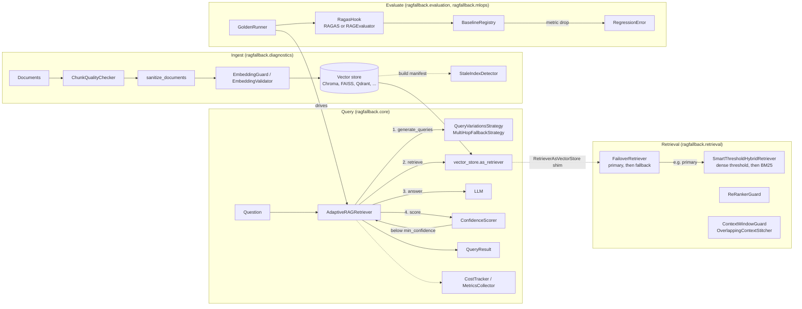

<div align="center">

# ragfallback

**A reliability layer for LangChain RAG pipelines: catch bad chunks and broken embeddings before indexing, fail over when retrieval comes back empty, retry low-confidence answers, and gate releases on evaluation metrics.**

[](https://pypi.org/project/ragfallback/)
[](https://pypi.org/project/ragfallback/)
[](https://pepy.tech/projects/ragfallback)
[](https://github.com/irfanalidv/ragfallback/actions/workflows/ci.yml)
[](https://github.com/irfanalidv/ragfallback/actions/workflows/codeql.yml)
[](https://github.com/irfanalidv/ragfallback/blob/main/LICENSE)
[](https://github.com/astral-sh/ruff)
[](https://mypy-lang.org/)
[](https://github.com/irfanalidv/ragfallback/blob/main/CONTRIBUTING.md)

</div>

## Why ragfallback?

RAG pipelines rarely fail loudly. They return an empty context, a half-relevant chunk, or a confident-sounding wrong answer, and nothing in a typical LangChain + vector-store stack tells you it happened. ragfallback is not another retrieval framework: it is a set of guards, fallbacks, and checks that wrap the retriever, vector store, and LLM you already use, so degradation shows up in a log line or a failed CI job instead of a support ticket.

| If your stack today is...                         | ragfallback adds                                                                                     |
| ------------------------------------------------- | ---------------------------------------------------------------------------------------------------- |
| A raw LangChain retriever with no fallback        | `FailoverRetriever` and `SmartThresholdHybridRetriever`: a second path when the first comes back empty |
| RAGAS or another eval library, run by hand        | `GoldenRunner` + `BaselineRegistry`: the same metrics wired into a gate that fails the build          |
| Nothing: chunking and indexing "just work"        | `ChunkQualityChecker` + `EmbeddingGuard`: the two most common silent corruption sources               |
| Hand-rolled retry logic around an LLM call        | `AdaptiveRAGRetriever`: confidence-scored retries with pluggable strategies, sync and async           |

## Features

| #  | Production failure                                    | Module                                             | Recipe                                  |
|----|-------------------------------------------------------|----------------------------------------------------|-----------------------------------------|
| 1  | Query wording mismatch, so retrieval silently misses  | `AdaptiveRAGRetriever` + `QueryVariationsStrategy` | `offline_support_bot.py`                |
| 2  | Embedding model switch corrupts index dimensions      | `EmbeddingGuard`, `EmbeddingValidator`             | `offline_ingest_preflight.py`           |
| 3  | Bad chunks (too short, too long, mid-sentence)        | `ChunkQualityChecker` (`check`, `auto_fix`)        | `offline_ingest_preflight.py`           |
| 4  | Retrieved chunks overflow the LLM context window      | `ContextWindowGuard` (10 model presets)             | `offline_hybrid_failover.py`            |
| 5  | Keyword and acronym queries fail dense retrieval      | `SmartThresholdHybridRetriever` (BM25 fallback)    | `offline_hybrid_failover.py`            |
| 6  | Primary retriever outage returns nothing              | `FailoverRetriever`                                | `offline_hybrid_failover.py`            |
| 7  | Multi-step questions fail single-shot RAG             | `MultiHopFallbackStrategy`                         | `uc6_multi_hop_demo.py`                 |
| 8  | Index serves stale data after document updates        | `StaleIndexDetector` (SHA-256 manifest)            | `offline_ingest_preflight.py`           |
| 9  | Metadata a vector store rejects (lists, dicts, bytes) | `sanitize_documents`, `sanitize_metadata`          | `offline_ingest_preflight.py`           |
| 10 | Answers split across adjacent chunks                  | `OverlappingContextStitcher`                       | `uc8_context_stitcher.py`               |
| 11 | Answer quality invisible in production                | `RAGEvaluator` (heuristic or LLM judge)            | `uc7_rag_evaluator.py`                  |
| 12 | Metric regression after a model, embedder, or chunker change | `GoldenRunner` + `BaselineRegistry` + `RagasHook` | `offline_eval_gate.py`           |
| 13 | LLM spend and retry rates nobody tracks               | `CostTracker`, `MetricsCollector`, `CacheMonitor`  | `offline_support_bot.py`                |

Everything except the LLM-driven strategies runs locally with no API key. The whole package is type-annotated and ships `py.typed`.

## Install

```bash
pip install ragfallback                         # core
pip install "ragfallback[hybrid]"               # + BM25 fallback (rank_bm25, faiss-cpu)
pip install "ragfallback[chroma,huggingface]"   # local Chroma + sentence-transformers, no API key
pip install "ragfallback[mlops]"                # + RAGAS, MLflow, Locust for the eval layer
```

With [uv](https://docs.astral.sh/uv/):

```bash
uv add ragfallback            # or: uv pip install "ragfallback[hybrid]"
```

<details>
<summary>All extras</summary>

| Extra                   | Installs                                                                  |
| ----------------------- | ------------------------------------------------------------------------- |
| `hybrid`                | rank_bm25, faiss-cpu                                                      |
| `faiss` / `chroma` / `qdrant` | faiss-cpu / chromadb / qdrant-client                                |
| `huggingface`           | sentence-transformers, transformers, huggingface-hub, langchain-huggingface |
| `openai` / `anthropic` / `mistral` | the matching LangChain chat-model package                      |
| `real-data`             | datasets (for the SQuAD / PubMedQA / CUAD examples)                       |
| `mlops`                 | ragas, mlflow, locust, aiohttp                                            |
| `open-source` / `paid` / `all` | convenience bundles, see `pyproject.toml`                          |
| `dev`                   | pytest, pytest-cov, ruff, mypy, pre-commit, build, twine                  |

</details>

Requires Python 3.10+. Tested with LangChain 1.x on Python 3.10-3.13.

## Quickstart

Runs as-is with no API key or model download (`DeterministicFakeEmbedding` stands in for your embedder):

```python
from langchain_core.documents import Document
from langchain_core.embeddings import DeterministicFakeEmbedding  # stand-in: use your embedder
from langchain_core.runnables import RunnableLambda
from langchain_core.vectorstores import InMemoryVectorStore

from ragfallback.diagnostics import ChunkQualityChecker, EmbeddingGuard, sanitize_documents
from ragfallback.evaluation import RAGEvaluator
from ragfallback.retrieval import FailoverRetriever

docs = [
    Document(
        page_content="The refund window is 30 days from the original purchase date.",
        metadata={"source": "billing.md", "tags": ["billing", "refunds"]},
    ),
    Document(page_content="See above.", metadata={"source": "billing.md"}),
]
report = ChunkQualityChecker(min_chars=20, target_overlap_ratio=0).check(docs)
print(report.violations)  # ['chunk[1] too short (10 chars, 2 words; ...)']
docs = sanitize_documents(docs[:1])  # list metadata -> JSON string, safe for any store

embeddings = DeterministicFakeEmbedding(size=384)
EmbeddingGuard(expected_dim=384).validate(embeddings).raise_if_failed()  # raises on mismatch
store = InMemoryVectorStore.from_documents(docs, embeddings)

empty_index = RunnableLambda(lambda q: [])  # a primary index that silently returns nothing
retriever = FailoverRetriever(primary=empty_index, fallback=store.as_retriever(), min_results=1)
hits = retriever.invoke("How long is the refund window?")
print(hits[0].metadata["ragfallback_retrieval_source"])  # secondary_failover

score = RAGEvaluator().evaluate(
    "How long is the refund window?",
    "The refund window is 30 days from the original purchase date.",
    [d.page_content for d in hits],
    ground_truth="30 days",
)
print(f"overall={score.overall_score:.2f} passed={score.passed}")  # overall=0.87 passed=True
```

### Retry low-confidence answers (needs an LLM)

`AdaptiveRAGRetriever` retrieves, answers, scores confidence, and moves to the next query or strategy when confidence is below `min_confidence`. Any LangChain chat model works. This snippet needs `pip install "ragfallback[openai]"` and `OPENAI_API_KEY`:

```python
from langchain_core.vectorstores import InMemoryVectorStore
from langchain_openai import ChatOpenAI, OpenAIEmbeddings

from ragfallback import AdaptiveRAGRetriever, CostTracker
from ragfallback.strategies import QueryVariationsStrategy

embeddings = OpenAIEmbeddings(model="text-embedding-3-small")
store = InMemoryVectorStore.from_texts(
    [
        "The refund window is 30 days from the original purchase date.",
        "API tokens expire after 90 days and must be rotated.",
    ],
    embeddings,
)
retriever = AdaptiveRAGRetriever(
    vector_store=store,
    llm=ChatOpenAI(model="gpt-4o-mini", temperature=0),
    embedding_model=embeddings,
    fallback_strategies=[QueryVariationsStrategy(num_variations=2)],
    max_attempts=3,
    min_confidence=0.7,
    cost_tracker=CostTracker(budget=0.10),
)
result = retriever.query_with_fallback("How long do I have to get my money back?")
print(result.answer, result.confidence, result.attempts, result.cost)
```

To see the retry path without a key, run [`examples/offline_support_bot.py`](https://github.com/irfanalidv/ragfallback/blob/main/examples/offline_support_bot.py): the first attempt answers "Not found", is rejected on confidence, and the rewritten query ("refund window") succeeds on attempt 2.

`aquery_with_fallback()` is the native async version: it uses `ainvoke()` on the retriever and LLM and falls back to a thread pool when a component has no async implementation.

## Architecture



Key design decisions:

- **Wrap, don't replace.** Every component takes LangChain objects (`Embeddings`, `VectorStore`, `BaseRetriever`, chat models) and returns LangChain `Document`s, so it drops into an existing pipeline. Custom retrievers plug into `AdaptiveRAGRetriever` through the `RetrieverAsVectorStore` shim.
- **Fail soft at query time, fail hard at build time.** Retrieval-time components degrade (fallback index, BM25, best-effort answer) and log a warning. Ingest-time and CI components (`EmbeddingGuard.raise_if_failed`, `BaselineRegistry.compare_or_fail`) raise, because that is where a hard stop is cheap.
- **Confidence-gated retries.** An attempt is accepted only when `ConfidenceScorer` returns at least `min_confidence` and the answer is not a "not found" placeholder. Otherwise the next query or strategy runs, up to `max_attempts`; if every attempt fails, the highest-confidence answer is returned with its score so callers can decide.
- **Optional dependencies stay optional.** BM25, RAGAS, MLflow, tiktoken, and every vector-store client are imported lazily; without them the code falls back (for example `RagasHook` uses the heuristic `RAGEvaluator`) or raises an `ImportError` naming the extra to install.

## Use cases and recipes

Offline recipes (no API key, no downloads; they use the bundled [`examples/sample_kb`](https://github.com/irfanalidv/ragfallback/tree/main/examples/sample_kb) and are run in CI):

| Script | What it shows |
| ------ | ------------- |
| [`offline_support_bot.py`](https://github.com/irfanalidv/ragfallback/blob/main/examples/offline_support_bot.py) | Customer-support bot recovers from "money back" vs "refund window" via query rewriting; reports retries and estimated spend |
| [`offline_ingest_preflight.py`](https://github.com/irfanalidv/ragfallback/blob/main/examples/offline_ingest_preflight.py) | Chunk checks + `auto_fix`, metadata sanitization, embedding-width guard, stale-index diff after doc edits |
| [`offline_hybrid_failover.py`](https://github.com/irfanalidv/ragfallback/blob/main/examples/offline_hybrid_failover.py) | Keyword queries ("PKCE", "Retry-After") routed to BM25, a dead primary index failed over, context trimmed to a budget (needs `[hybrid]`) |
| [`offline_eval_gate.py`](https://github.com/irfanalidv/ragfallback/blob/main/examples/offline_eval_gate.py) | Golden-set run, baseline saved, then an ingestion bug caught by `RegressionError` |

<details>
<summary>Examples on real public datasets (need model downloads; some need an LLM)</summary>

| Example                     | Dataset                                         | Command                                         |
| --------------------------- | ----------------------------------------------- | ----------------------------------------------- |
| UC-1: retrieval health      | SQuAD Wikipedia                                 | `python examples/uc1_retrieval_health.py`       |
| UC-2: embedding guard       | (dimension check)                               | `python examples/uc2_embedding_guard.py`        |
| UC-3: chunk quality         | SQuAD Wikipedia                                 | `python examples/uc3_chunk_quality.py`          |
| UC-4: context window        | sample KB                                       | `python examples/uc4_context_window.py`         |
| UC-5: hybrid + failover     | FAISS + BM25                                    | `python examples/uc5_hybrid_failover.py`        |
| UC-6: adaptive RAG          | SQuAD Wikipedia (needs `MISTRAL_API_KEY` or Ollama) | `python examples/uc6_adaptive_rag.py`       |
| UC-6b: multi-hop            | needs an LLM                                    | `python examples/uc6_multi_hop_demo.py`         |
| UC-7: RAG evaluator         | PubMedQA (MIT)                                  | `python examples/uc7_rag_evaluator.py`          |
| UC-8: context stitcher      | ChromaDB + HR chunks                            | `python examples/uc8_context_stitcher.py`       |
| UC-9: embedding probe       | (similarity check)                              | `python examples/uc9_embedding_probe.py`        |
| UC-10: metadata sanitizer   | ChromaDB dirty docs                             | `python examples/uc10_metadata_sanitizer.py`    |
| End-to-end on SQuAD         | SQuAD Wikipedia (CC BY-SA 4.0)                  | `python examples/real_data_demo.py`             |
| Financial news RAG          | nickmuchi/financial-classification (Apache 2.0) | `python examples/financial_risk_analysis.py`    |
| Legal contract RAG          | theatticusproject/cuad-qa (CC BY 4.0)           | `python examples/legal_document_analysis.py`    |
| Medical abstract RAG        | qiaojin/PubMedQA (MIT)                          | `python examples/medical_research_synthesis.py` |
| MLOps: build golden dataset | SQuAD (CC BY-SA 4.0) + SciQ (CC BY-NC 3.0)      | `python examples/build_golden_dataset.py`       |
| MLOps: full demo            | SQuAD golden set, no API keys                   | `python examples/mlops_demo.py`                 |
| MLOps: CI regression gate   | SQuAD golden set, committed baseline            | `python examples/ci_regression_gate.py`         |

There is also a [Colab notebook](https://colab.research.google.com/github/irfanalidv/ragfallback/blob/main/ragfallback_colab.ipynb).

**Numbers from `examples/real_data_demo.py`** (200 SQuAD validation passages, `all-MiniLM-L6-v2`, heuristic evaluation with no LLM judge; latency depends on your machine):

```
ChunkQualityChecker  : 1 violation (low neighbour overlap; avg 662 chars/passage)
EmbeddingGuard       : OK, dim 384 matches expected 384
RetrievalHealthCheck : 100.0% hit rate on 20 real Q&A substring probes
RAGEvaluator (10 Q&A): pass rate 2/10, avg recall@k 100.0%, avg faithfulness 79.5%, avg overall 62.9%
```

Install for these: `pip install "ragfallback[chroma,huggingface,real-data]"`.

</details>

## Configuration

Most features need no configuration. LLM-backed features read the usual provider variables through LangChain; the helpers in `ragfallback.utils` read these:

| Variable | Used by | Default |
| -------- | ------- | ------- |
| `MISTRAL_API_KEY` (or `MISTRAL_API_TOKEN`) | `create_mistral_llm`, `create_llm_from_env`, LLM examples and tests | unset |
| `MISTRAL_MODEL` | `create_mistral_llm`, `create_llm_from_env` | `mistral-small-latest` |
| `OPENAI_API_KEY`, `ANTHROPIC_API_KEY` | `create_openai_llm` / `create_anthropic_llm` (read by the LangChain client) | unset |
| `OLLAMA_MODEL`, `OLLAMA_BASE_URL` | `examples/chroma_real_kb_demo.py` | `llama3`, `http://localhost:11434` |

`load_env()` loads a `.env` file when `python-dotenv` is installed (copy `.env.example`).

Main options:

| Component | Option | Default | Meaning |
| --------- | ------ | ------- | ------- |
| `AdaptiveRAGRetriever` | `min_confidence` | `0.7` | Accept an answer at or above this confidence |
| | `max_attempts` | `3` | Total retrieval + answer attempts across strategies |
| | `fallback_strategies` | `[QueryVariationsStrategy()]` | Ordered strategies to try |
| `CostTracker` | `budget`, `alert_threshold`, `pricing_config` | `None`, `0.8`, built-in table | USD budget, warning ratio, per-1M-token prices (prefix-matched model names). The built-in table covers OpenAI, Anthropic and Mistral list prices as of `ragfallback.tracking.cost_tracker.PRICING_AS_OF` (2026-10-31); unknown models are priced at the `gpt-4` rate so budgets fail safe |
| `FailoverRetriever` | `min_results` | `1` | Fewer results than this from `primary` triggers the fallback |
| `SmartThresholdHybridRetriever` | `score_mode`, `min_similarity` / `max_distance`, `fetch_k`, `final_k` | `"distance"`, `0.7` / `None`, `20`, `5` | How dense scores are thresholded before BM25 takes over |
| `ContextWindowGuard` | `max_context_tokens` or `from_model_name(...)` | `6000` | Token budget for retrieved context |
| `BaselineRegistry.compare_or_fail` | `threshold`, `latency_threshold` | `0.05`, same | Allowed relative drop per metric (latency: allowed rise) |
| `CacheMonitor` | `max_size`, `ttl_seconds` | `256`, `300` | LRU size and TTL for cached retrievals |

## API overview

| Import | What it does |
| ------ | ------------ |
| `ragfallback.AdaptiveRAGRetriever` | Retrieve, answer, score, retry; `query_with_fallback()` / `aquery_with_fallback()` return a `QueryResult(answer, source, confidence, attempts, cost, intermediate_steps)` |
| `ragfallback.strategies.QueryVariationsStrategy` | LLM rewrites of the question (original first on attempt 1) |
| `ragfallback.strategies.MultiHopFallbackStrategy` | Decompose into sub-questions, retrieve each, synthesise; `run(question, retriever, llm)` returns `MultiHopResult` |
| `ragfallback.diagnostics.ChunkQualityChecker` | `check()` size, word-count, sentence-boundary, and neighbour-overlap report; `auto_fix()` merge-and-split repair |
| `ragfallback.diagnostics.EmbeddingGuard` | Dimension, zero-vector, and NaN checks for a model, a batch, or raw vectors |
| `ragfallback.diagnostics.EmbeddingValidator` | Compare the model's width with what the vector store reports |
| `ragfallback.diagnostics.EmbeddingQualityProbe` | Heuristic domain-fit check from query-to-reference similarity |
| `ragfallback.diagnostics.RetrievalHealthCheck` | Labeled recall@k (`run`), substring smoke probes, or `quick_check` from random docs |
| `ragfallback.diagnostics.StaleIndexDetector` | SHA-256 manifest of source files or chunk contents; reports changed / removed / new |
| `ragfallback.diagnostics.ContextWindowGuard` | Rank by similarity and pack into a token budget; optional lost-in-the-middle reordering |
| `ragfallback.diagnostics.OverlappingContextStitcher` | Merge consecutive `chunk_index` chunks from the same source |
| `ragfallback.diagnostics.sanitize_documents` | Flatten list / dict / bytes metadata to JSON-safe scalars |
| `ragfallback.retrieval.FailoverRetriever` | Primary, then fallback on exception or too few results |
| `ragfallback.retrieval.SmartThresholdHybridRetriever` | Score threshold on dense results, BM25 when nothing survives |
| `ragfallback.retrieval.ReRankerGuard` | Slot for a second-stage reranker (`rerank_fn`) plus `top_n` cut |
| `ragfallback.retrieval.RetrieverAsVectorStore` | Use any retriever where `AdaptiveRAGRetriever` expects a vector store |
| `ragfallback.evaluation.RAGEvaluator` | Context precision, faithfulness, relevance, gold recall; heuristic or LLM judge |
| `ragfallback.evaluation.recall_at_k`, `ndcg_at_k` | Ranking metrics |
| `ragfallback.CostTracker`, `MetricsCollector`, `CacheMonitor` | Spend per operation and budget, success / attempts / latency, retrieval cache hit rate |
| `ragfallback.mlops.GoldenRunner`, `RagasHook`, `BaselineRegistry` | Golden-set evaluation, RAGAS (or heuristic) scoring, regression gate |
| `ragfallback.mlops.QuerySimulator`, `generate_locustfile`, `MLflowLogger` | Adversarial query variants, Locust load test file, MLflow logging |

<details>
<summary>Module reference with snippets</summary>

The snippets below assume `docs` (a list of `Document`), `embeddings`, `store` (a vector store), and, where noted, `llm`.

**Diagnostics**

```python
from ragfallback.diagnostics import (
    ChunkQualityChecker,
    ContextWindowGuard,
    EmbeddingGuard,
    EmbeddingQualityProbe,
    OverlappingContextStitcher,
    RetrievalHealthCheck,
    StaleIndexDetector,
)

report = ChunkQualityChecker(min_chars=100, max_chars=8000).check(docs)
if report.has_issues:
    fixed_texts = ChunkQualityChecker().auto_fix(docs)  # list[str]; review before embedding

EmbeddingGuard(expected_dim=384).validate(embeddings).raise_if_failed()
EmbeddingGuard.validate_raw_vectors([[0.1, 0.2], [0.3, 0.4]], expected_dim=2).raise_if_failed()

probe = EmbeddingQualityProbe().run(
    embeddings, query="refund policy", reference_snippets=["Refunds are issued within 30 days."]
)
print(probe.ok, probe.warnings)

health = RetrievalHealthCheck(k=5).run_substring_probes(store, {"refund window": "30 days"})
print(health.hit_rate, health.avg_latency_ms)

detector = StaleIndexDetector(manifest_path="index_manifest.json")
detector.record_paths(["docs/policy.md"])  # after an index build
print(detector.check_paths(["docs/policy.md"]).summary())  # before serving

guard = ContextWindowGuard.from_model_name("gpt-4o")
selected, window = guard.select("refund policy", docs, embeddings)
merged = OverlappingContextStitcher().stitch(selected)
```

**Retrieval**

```python
from ragfallback import AdaptiveRAGRetriever
from ragfallback.retrieval import (
    FailoverRetriever,
    ReRankerGuard,
    RetrieverAsVectorStore,
    SmartThresholdHybridRetriever,
)

hybrid = SmartThresholdHybridRetriever.from_documents(  # needs ragfallback[hybrid]
    docs, vectorstore=store, score_mode="similarity", min_similarity=0.5, final_k=4
)
failover = FailoverRetriever(primary=hybrid, fallback=store.as_retriever(), min_results=1)
top = ReRankerGuard(rerank_fn=lambda q, ds: ds, top_n=3).apply("q", failover.invoke("q"))

# needs an LLM: plug any retriever into the retry loop
adaptive = AdaptiveRAGRetriever(
    vector_store=RetrieverAsVectorStore(hybrid), llm=llm, embedding_model=embeddings
)
```

**Tracking**

```python
from ragfallback import CacheMonitor, CostTracker, MetricsCollector

costs = CostTracker(budget=1.0)
with costs.track("answer_generation"):
    costs.record_tokens(input_tokens=500, output_tokens=200, model="gpt-4o-mini")
print(costs.get_report())  # total_cost, total_tokens, breakdown, budget_remaining, ...

metrics = MetricsCollector()  # AdaptiveRAGRetriever records into this automatically
metrics.record_success(attempts=1, confidence=0.85, cost=0.0002, latency_ms=120)
print(metrics.get_stats())

monitor = CacheMonitor(max_size=512, ttl_seconds=600)
cached = monitor.wrap_retriever(store.as_retriever(search_kwargs={"k": 4}))
cached.invoke("refund policy")
cached.invoke("refund policy")
print(monitor.summary())  # cache hit_rate=50.0% hits=1 misses=1 entries=1 evictions=0
```

**Multi-hop (needs an LLM)**

```python
from ragfallback.strategies import MultiHopFallbackStrategy

result = MultiHopFallbackStrategy(max_hops=3).run(
    "Which team won the game that was held at the stadium in Santa Clara?",
    retriever=store.as_retriever(),
    llm=llm,
)
print(result.final_answer, result.total_hops)
```

</details>

<details>
<summary>MLOps: evaluation and regression gate</summary>

```python
import asyncio
from ragfallback.mlops import BaselineRegistry, GoldenRunner, RagasHook

hook = RagasHook(llm=None, embeddings=embeddings)  # RAGAS when installed, else heuristics
runner = GoldenRunner(retriever=adaptive, ragas_hook=hook, dataset="examples/golden_qa.json")
report = asyncio.run(runner.run_async())
print(report.recall_at_3, report.ragas.faithfulness, report.latency_p95_ms, report.fallback_rate)

registry = BaselineRegistry("baselines.json")
registry.compare_or_fail(report, dataset="squad")  # raises RegressionError on a >5% drop
registry.update(report, dataset="squad")
```

Pass `cache_monitor=CacheMonitor(...)` to `GoldenRunner` to get `report.cache_stats` (`cache_hits`, `cache_misses`, `hit_rate`, ...).

Adversarial queries and load tests:

```python
from ragfallback.mlops import QuerySimulator, generate_locustfile

variants = QuerySimulator().simulate_unhappy_paths(["What is the refund policy?"])
# short_keyword, long_nl, ambiguous, out_of_domain for every query
generate_locustfile("locustfile.py", endpoint="http://localhost:8000")
```

The `mlops-regression-gate` job in [`.github/workflows/ci.yml`](https://github.com/irfanalidv/ragfallback/blob/main/.github/workflows/ci.yml) builds a 75-question SQuAD golden set, indexes it in Chroma with `all-MiniLM-L6-v2` (no API key), runs `GoldenRunner`, and calls `compare_or_fail()` against the committed `examples/baselines.json` (5% tolerance on quality metrics; P95 latency is given a 500% allowance because shared CI runners are too noisy to gate on). Locally:

```bash
pip install "ragfallback[chroma,huggingface,real-data,mlops]"
python examples/build_golden_dataset.py   # one-time
python examples/ci_regression_gate.py     # exit 0 = pass, 1 = regression
```

</details>

## Research and references

ragfallback implements or wraps these published methods:

- **BM25** keyword fallback in `SmartThresholdHybridRetriever` (via `rank_bm25` / LangChain `BM25Retriever`): S. Robertson and H. Zaragoza, "The Probabilistic Relevance Framework: BM25 and Beyond," *Foundations and Trends in Information Retrieval*, 3(4), 2009.
- **nDCG** in `ragfallback.evaluation.ndcg_at_k`: K. Järvelin and J. Kekäläinen, "Cumulated gain-based evaluation of IR techniques," *ACM Transactions on Information Systems*, 20(4), 2002.
- **RAGAS** metrics (faithfulness, answer relevancy, context precision and recall) through `RagasHook`: S. Es, J. James, L. Espinosa-Anke, and S. Schockaert, "RAGAs: Automated Evaluation of Retrieval Augmented Generation," *EACL 2024 System Demonstrations*.
- The `lost_in_middle=True` option of `ContextWindowGuard` moves the second-most-relevant chunk to the end of the context, a mitigation for the position effect reported in N. F. Liu et al., "Lost in the Middle: How Language Models Use Long Contexts," *TACL*, 12, 2024.

## When to use it

- **Use it** when you already have a LangChain retriever and LLM and want guards, fallbacks, and a CI gate around them without migrating to a new framework.
- **Use RAGAS directly** if you only need offline answer-quality scores; ragfallback's `RagasHook` calls RAGAS when it is installed, and the rest of the library is about preventing failures before evaluation.
- **Look elsewhere** if you are not on LangChain primitives, or you need a full orchestration framework (agents, routing, document loaders); ragfallback deliberately stays a thin layer.

<details>
<summary>FAQ</summary>

**Does this replace LangChain, LlamaIndex, or my vector DB?**
No. It wraps the retriever and vector store you already use and adds checks and fallback paths.

**Do I need an LLM API key?**
Not for most of it. Diagnostics, `FailoverRetriever`, `SmartThresholdHybridRetriever`, `ContextWindowGuard`, `RAGEvaluator` (heuristic mode), tracking, and the MLOps gate run locally. `AdaptiveRAGRetriever`, `QueryVariationsStrategy`, and `MultiHopFallbackStrategy` need a LangChain chat model; local Ollama models work.

**Why do the real-dataset example numbers vary between runs?**
They are computed live against public datasets (SQuAD, PubMedQA, CUAD), and latency depends on hardware.

**How stable is the API?**
Releases follow semantic versioning. Pin a version in production and read the [CHANGELOG](https://github.com/irfanalidv/ragfallback/blob/main/CHANGELOG.md) before upgrading.

</details>

## Roadmap

- Embedding-similarity confidence scoring (the `embedding_similarity` method of `ConfidenceScorer` currently falls back to the heuristic).
- Built-in cross-encoder option for `ReRankerGuard`.
- Move vector-store factories off `langchain-community` (being sunset) to the standalone integration packages.

## Contributing, security, citation, license

- Contributions are welcome: see [CONTRIBUTING.md](https://github.com/irfanalidv/ragfallback/blob/main/CONTRIBUTING.md) and the [Code of Conduct](https://github.com/irfanalidv/ragfallback/blob/main/CODE_OF_CONDUCT.md). CI runs `ruff check`, `ruff format --check`, `mypy ragfallback`, and `pytest --cov` on Python 3.10-3.13.
- Report vulnerabilities privately as described in [SECURITY.md](https://github.com/irfanalidv/ragfallback/blob/main/SECURITY.md).
- If you use ragfallback in research, please cite it using [CITATION.cff](https://github.com/irfanalidv/ragfallback/blob/main/CITATION.cff) (GitHub's "Cite this repository" button reads it).
- Release history: [CHANGELOG.md](https://github.com/irfanalidv/ragfallback/blob/main/CHANGELOG.md).
- MIT License, see [LICENSE](https://github.com/irfanalidv/ragfallback/blob/main/LICENSE). Maintained by [Irfan Ali](https://github.com/irfanalidv).
